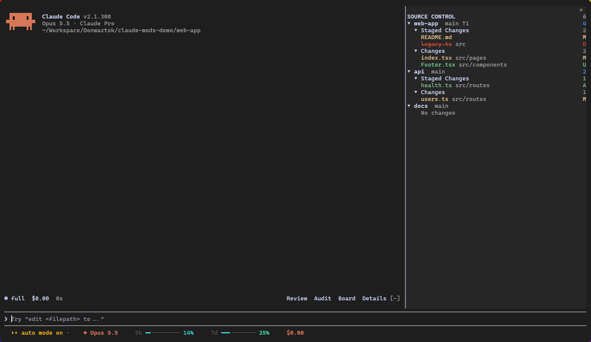
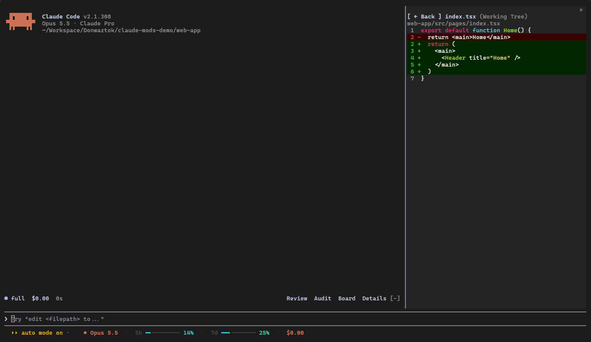

# claude-mods

Mods para o [Claude Code](https://claude.com/claude-code).

## git-changes

Painel **Source Control** no estilo do VS Code. Lê os `folders` do `.code-workspace` da pasta onde o Claude abriu (sem ele, usa o próprio repositório ou os repositórios das subpastas) e mostra, por projeto, a branch, ↑/↓ em relação ao remoto, e os grupos **Staged Changes** e **Changes** com a letra de status nas cores do VS Code. Clicar num arquivo mostra o diff do arquivo inteiro; **← Back** (ou `b`) volta.





- Abre sozinho a partir de 144 colunas, ou com `/git-changes`.
- Atualiza a cada 4 s e depois de cada ferramenta que o Claude roda.
- Com o painel aberto, a faixa de plugins acima do prompt (a do ponytail, por exemplo) vai para o rodapé do painel e libera espaço. Os botões de outros plugins viram texto; Review, Audit e Board do ponytail continuam clicáveis; Details não (é um estado interno do ponytail).
- Fechado no ✕, a faixa volta com um botão **⎇ Source Control** para reabrir.
- Para pegar a faixa de outro plugin, o git-changes precisa vir antes dele em `enabledPlugins` no `~/.claude/settings.json` (os plugins são chamados nessa ordem):
  ```json
  "enabledPlugins": {
    "git-changes@donwaztok": true,
    "ponytail@ponytail": true
  }
  ```

## usage-line

Barras animadas de uso ao lado da dica do prompt: modelo, contexto, limites de 5h/7d e custo da sessão. Aparece na última linha dos prints acima.

## Instalar

No prompt do Claude Code:

```
/plugin install git-changes --marketplace Donwaztok/claude-mods
/plugin install usage-line --marketplace Donwaztok/claude-mods
```

Responda `y` para adicionar o marketplace e escolha o escopo de usuário (vale para todas as sessões).

Pelo terminal:

```
claude plugin install git-changes --marketplace Donwaztok/claude-mods
claude plugin install usage-line --marketplace Donwaztok/claude-mods
```

No app desktop, onde `/plugin` não roda: clique em + ao lado da caixa do prompt, depois Plugins, Add marketplace com `Donwaztok/claude-mods`, depois Add plugin.

## Desenvolver

```
claude plugin validate plugins/git-changes
claude plugin test plugins/git-changes
```
